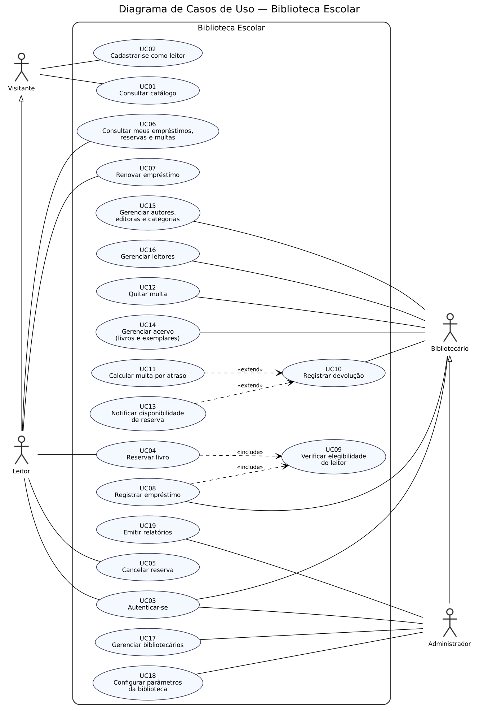

# Documento de Casos de Uso — Biblioteca Escolar

## 1. Visão geral do sistema

O **Biblioteca Escolar** é um sistema desktop (Java 21, JavaFX, SQLite) que informatiza o controle de uma biblioteca de escola técnica: consulta ao catálogo, cadastro de leitores, empréstimo, renovação e devolução de exemplares, reservas com fila, cálculo e quitação de multas por atraso, cadastro do acervo e relatórios gerenciais. O acesso é controlado por autenticação com quatro perfis (Visitante, Leitor, Bibliotecário e Administrador), cada um com um conjunto próprio de funções.

## 2. Atores

| Ator | Descrição |
|---|---|
| **Visitante** | Pessoa sem login. Pode consultar o catálogo e se cadastrar como leitor. |
| **Leitor** | Aluno ou professor cadastrado. Herda as funções do Visitante e, autenticado, reserva livros, renova empréstimos e consulta os próprios empréstimos, reservas e multas. |
| **Bibliotecário** | Funcionário do balcão. Registra empréstimos e devoluções, quita multas e mantém acervo, cadastros auxiliares e leitores. |
| **Administrador** | Coordenação. Herda todas as funções do Bibliotecário e ainda gerencia bibliotecários, configura os parâmetros da biblioteca e emite relatórios. |

## 3. Lista de casos de uso e rastreabilidade

| ID | Caso de uso | Ator principal | Histórias de origem | Tipo |
|---|---|---|---|---|
| UC01 | Consultar catálogo | Visitante | US02 | Consulta |
| UC02 | Cadastrar-se como leitor | Visitante | US04 | CRUD |
| UC03 | Autenticar-se | Leitor, Bibliotecário, Administrador | US03 | Regra |
| UC04 | Reservar livro | Leitor | US09 | Regra |
| UC05 | Cancelar reserva | Leitor | US17 | Regra |
| UC06 | Consultar meus empréstimos, reservas e multas | Leitor | US10 | Consulta |
| UC07 | Renovar empréstimo | Leitor | US11 | Regra |
| UC08 | Registrar empréstimo | Bibliotecário | US05 | Regra |
| UC09 | Verificar elegibilidade do leitor | Bibliotecário | US07 | Regra |
| UC10 | Registrar devolução | Bibliotecário | US06 | Regra |
| UC11 | Calcular multa por atraso | Bibliotecário | US08 | Cálculo |
| UC12 | Quitar multa | Bibliotecário | US12 | Regra |
| UC13 | Notificar disponibilidade de reserva | Bibliotecário | US18 | Regra |
| UC14 | Gerenciar acervo (livros e exemplares) | Bibliotecário | US01 | CRUD |
| UC15 | Gerenciar autores, editoras e categorias | Bibliotecário | US13 | CRUD |
| UC16 | Gerenciar leitores | Bibliotecário | US14 | CRUD |
| UC17 | Gerenciar bibliotecários | Administrador | US15 | CRUD |
| UC18 | Configurar parâmetros da biblioteca | Administrador | US16 | Regra |
| UC19 | Emitir relatórios | Administrador | US19, US20 | Consulta |

Toda história de usuário (US01 a US20) origina ao menos um caso de uso.

### Relações entre casos de uso

| Relação | De | Para | Motivo |
|---|---|---|---|
| `<<include>>` | UC04 Reservar livro | UC09 Verificar elegibilidade | A verificação sempre ocorre antes de reservar. |
| `<<include>>` | UC08 Registrar empréstimo | UC09 Verificar elegibilidade | A verificação sempre ocorre antes de emprestar. |
| `<<extend>>` | UC11 Calcular multa | UC10 Registrar devolução | Só ocorre se a devolução for após a data prevista. |
| `<<extend>>` | UC13 Notificar disponibilidade | UC10 Registrar devolução | Só ocorre se houver reserva aguardando o título. |
| Generalização | Leitor | Visitante | O Leitor realiza tudo o que o Visitante realiza. |
| Generalização | Administrador | Bibliotecário | O Administrador realiza tudo o que o Bibliotecário realiza. |

### Conferência dos requisitos mínimos

| Dimensão | Exigido | Neste sistema |
|---|---|---|
| Atores | 3 a 6 | 4 |
| Casos de uso | 12 a 20 | 19 |
| CRUD puro (máx. metade) | ≤ 9 | 5 (UC02, UC14, UC15, UC16, UC17) |
| Classes de domínio | 9 a 13 | 12 (seção 5) |
| Entidade com ciclo de vida (≥ 4 estados) | 1 a 2 | Empréstimo (4 estados) e Reserva (5 estados) |
| Regras de negócio com cálculo ou validação | ≥ 2 | RN01, RN02, RN03, RN04, RN05, RN06 |
| Autenticação com perfis | obrigatória | UC03 e RN07 |

## 4. Diagrama de casos de uso

Ver `docs/diagramas/casos-de-uso.png` (fonte em `docs/diagramas/casos-de-uso.dot`).

## 5. Classes de domínio previstas

`Usuario` (com perfil), `Leitor`, `Livro`, `Exemplar`, `Autor`, `Editora`, `Categoria`, `Emprestimo`, `Reserva`, `Multa`, `Notificacao`, `ParametrosBiblioteca`.

Os diagramas de classes, sequência, atividades e estados serão entregues nas semanas seguintes.

## 6. Regras de negócio

As regras RN01 a RN08 estão descritas em `docs/elicitacao.md`, seção 6, e são citadas nas especificações abaixo.

## 7. Especificação dos casos de uso

Modelo: nome, atores, resumo, pré e pós-condições, fluxo principal, fluxos alternativos e de exceção, regras de negócio e origem.

---

### UC01 — Consultar catálogo
- **Ator principal:** Visitante (também usado pelo Leitor e demais perfis)
- **Resumo:** Permite pesquisar livros por título, autor ou categoria e ver a quantidade de exemplares disponíveis.
- **Pré-condições:** Nenhuma.
- **Pós-condições:** Nenhuma (apenas leitura).
- **Fluxo principal:**
  1. O ator informa um termo e escolhe o critério (título, autor ou categoria).
  2. O sistema busca os livros correspondentes.
  3. O sistema exibe a lista com título, autores, categoria e exemplares disponíveis.
  4. O ator seleciona um livro e o sistema exibe seus detalhes.
- **Fluxos alternativos:** A1 — Termo em branco: o sistema lista todo o acervo, paginado.
- **Fluxos de exceção:** E1 — Nenhum resultado: o sistema informa que nada foi encontrado.
- **Regras de negócio:** RN08 (a disponibilidade desconta exemplares emprestados, reservados para retirada e baixados).
- **Origem:** US02

### UC02 — Cadastrar-se como leitor
- **Ator principal:** Visitante
- **Resumo:** O visitante cria sua conta de leitor para poder reservar e pegar livros emprestados.
- **Pré-condições:** O ator não está autenticado.
- **Pós-condições:** Conta de leitor criada com perfil LEITOR e situação ativa.
- **Fluxo principal:**
  1. O ator escolhe "Cadastrar-se".
  2. O sistema solicita nome, matrícula, curso/turma, e-mail, login e senha.
  3. O ator preenche e confirma.
  4. O sistema valida os dados, grava o usuário e o leitor e informa o sucesso.
- **Fluxos de exceção:** E1 — Login ou matrícula já existente: o sistema recusa e pede outro valor. E2 — Campo obrigatório vazio ou senha fraca: o sistema indica o problema.
- **Regras de negócio:** RN07.
- **Origem:** US04

### UC03 — Autenticar-se
- **Atores principais:** Leitor, Bibliotecário, Administrador
- **Resumo:** O usuário se identifica com login e senha e passa a ter acesso às funções do seu perfil.
- **Pré-condições:** O usuário possui conta ativa.
- **Pós-condições:** Sessão iniciada com o perfil do usuário; o menu exibe somente as funções permitidas a esse perfil.
- **Fluxo principal:**
  1. O ator informa login e senha.
  2. O sistema valida as credenciais.
  3. O sistema identifica o perfil e abre a tela inicial correspondente.
- **Fluxos de exceção:** E1 — Credenciais inválidas: o sistema recusa e mantém a tela de login. E2 — Conta desativada ou leitor bloqueado para login: o sistema informa e não inicia a sessão. E3 — Três tentativas inválidas seguidas: o sistema aguarda 30 segundos antes de nova tentativa.
- **Regras de negócio:** RN07.
- **Origem:** US03

### UC04 — Reservar livro
- **Ator principal:** Leitor
- **Resumo:** O leitor entra na fila de um título sem exemplares disponíveis.
- **Pré-condições:** Leitor autenticado.
- **Pós-condições:** Reserva criada na situação AGUARDANDO, posicionada na fila por data.
- **Fluxo principal:**
  1. O leitor, na tela de um livro, escolhe "Reservar".
  2. O sistema executa **UC09 Verificar elegibilidade do leitor** (include).
  3. O sistema confirma que o título não tem exemplar disponível.
  4. O sistema cria a reserva e informa a posição do leitor na fila.
- **Fluxos alternativos:** A1 — Há exemplar disponível: o sistema orienta o leitor a retirá-lo no balcão e não cria reserva.
- **Fluxos de exceção:** E1 — Leitor não elegível (UC09): o sistema recusa e informa o motivo. E2 — Leitor já tem reserva ativa do título ou já está com um exemplar dele: o sistema recusa.
- **Regras de negócio:** RN04, RN06.
- **Origem:** US09

### UC05 — Cancelar reserva
- **Ator principal:** Leitor
- **Resumo:** O leitor desiste de uma reserva e libera sua posição.
- **Pré-condições:** Leitor autenticado com reserva na situação AGUARDANDO ou DISPONÍVEL.
- **Pós-condições:** Reserva na situação CANCELADA; se estava DISPONÍVEL, o exemplar é oferecido ao próximo da fila.
- **Fluxo principal:**
  1. O leitor abre suas reservas e escolhe uma para cancelar.
  2. O sistema pede confirmação.
  3. O leitor confirma.
  4. O sistema marca a reserva como CANCELADA e atualiza a fila.
- **Fluxos alternativos:** A1 — O leitor não confirma: nada é alterado.
- **Regras de negócio:** RN06.
- **Origem:** US17

### UC06 — Consultar meus empréstimos, reservas e multas
- **Ator principal:** Leitor
- **Resumo:** O leitor acompanha seus empréstimos com prazos, suas reservas com posição na fila e suas multas.
- **Pré-condições:** Leitor autenticado.
- **Pós-condições:** Nenhuma (apenas leitura).
- **Fluxo principal:**
  1. O leitor abre "Minha conta".
  2. O sistema lista empréstimos em aberto (com data prevista e situação), reservas (com situação e posição) e multas (valor e situação).
  3. O sistema destaca empréstimos atrasados e reservas com retirada disponível (notificações do UC13).
- **Fluxos alternativos:** A1 — O leitor escolhe ver o histórico: o sistema inclui os empréstimos já devolvidos.
- **Regras de negócio:** RN01, RN03.
- **Origem:** US10

### UC07 — Renovar empréstimo
- **Ator principal:** Leitor
- **Resumo:** O leitor estende o prazo de um empréstimo em aberto.
- **Pré-condições:** Leitor autenticado com empréstimo ATIVO ou RENOVADO.
- **Pós-condições:** Empréstimo na situação RENOVADO, com nova data prevista e contador de renovações incrementado.
- **Fluxo principal:**
  1. O leitor escolhe um empréstimo e a opção "Renovar".
  2. O sistema valida as condições da renovação.
  3. O sistema calcula a nova data prevista (data atual + prazo) e atualiza o empréstimo.
  4. O sistema exibe a nova data.
- **Fluxos de exceção:** E1 — Já houve 2 renovações. E2 — Empréstimo atrasado. E3 — Existe reserva de outro leitor para o título. Em todos, o sistema recusa e informa o motivo.
- **Regras de negócio:** RN01, RN05.
- **Origem:** US11

### UC08 — Registrar empréstimo
- **Ator principal:** Bibliotecário
- **Resumo:** Registra a retirada de um exemplar por um leitor.
- **Pré-condições:** Bibliotecário autenticado; exemplar e leitor cadastrados.
- **Pós-condições:** Empréstimo criado na situação ATIVO com data prevista; exemplar marcado como emprestado; se havia reserva DISPONÍVEL do leitor para o título, ela passa a ATENDIDA.
- **Fluxo principal:**
  1. O bibliotecário informa a matrícula do leitor e o tombo do exemplar.
  2. O sistema executa **UC09 Verificar elegibilidade do leitor** (include).
  3. O sistema confirma que o exemplar está disponível.
  4. O sistema calcula a data prevista (hoje + prazo) e registra o empréstimo.
  5. O sistema exibe o comprovante com a data de devolução.
- **Fluxos alternativos:** A1 — O exemplar está reservado para outro leitor (DISPONÍVEL): o sistema recusa; se for reserva do próprio leitor, atende a reserva.
- **Fluxos de exceção:** E1 — Leitor não elegível (UC09). E2 — Exemplar emprestado, baixado ou reservado para outro: o sistema recusa. E3 — Matrícula ou tombo inexistente.
- **Regras de negócio:** RN01, RN02, RN04, RN08.
- **Origem:** US05

### UC09 — Verificar elegibilidade do leitor
- **Ator principal:** Bibliotecário (acionado também pelo caso de uso do Leitor que reserva)
- **Resumo:** Valida se o leitor pode pegar um livro ou reservar.
- **Pré-condições:** Leitor identificado.
- **Pós-condições:** Resultado "elegível" ou "não elegível" com o motivo; nada é gravado.
- **Fluxo principal:**
  1. O sistema confirma que o leitor não está bloqueado.
  2. O sistema confirma que o leitor não possui multa pendente.
  3. O sistema conta os empréstimos em aberto e confirma que está abaixo do limite.
  4. O sistema retorna "elegível".
- **Fluxos de exceção:** E1 — Leitor bloqueado. E2 — Multa pendente. E3 — Limite de 3 empréstimos atingido (para reservas, o limite não se aplica). O sistema retorna "não elegível" com o motivo.
- **Regras de negócio:** RN02, RN04.
- **Origem:** US07

### UC10 — Registrar devolução
- **Ator principal:** Bibliotecário
- **Resumo:** Registra a devolução de um exemplar e encerra o empréstimo.
- **Pré-condições:** Bibliotecário autenticado; exemplar com empréstimo ATIVO, RENOVADO ou ATRASADO.
- **Pós-condições:** Empréstimo na situação DEVOLVIDO com data de devolução; exemplar liberado (ou reservado para o primeiro da fila).
- **Fluxo principal:**
  1. O bibliotecário informa o tombo do exemplar.
  2. O sistema localiza o empréstimo em aberto.
  3. O sistema compara a data atual com a data prevista.
  4. O sistema registra a devolução e libera o exemplar.
  5. O sistema exibe o comprovante.
- **Fluxos alternativos:**
  - A1 — Devolução após a data prevista: o sistema executa **UC11 Calcular multa por atraso** (extend).
  - A2 — Há reserva AGUARDANDO para o título: o sistema executa **UC13 Notificar disponibilidade de reserva** (extend).
- **Fluxos de exceção:** E1 — Exemplar sem empréstimo em aberto: o sistema informa e nada altera.
- **Regras de negócio:** RN03, RN06, RN08.
- **Origem:** US06

### UC11 — Calcular multa por atraso
- **Ator principal:** Bibliotecário (executado dentro da devolução)
- **Resumo:** Calcula e registra a multa quando a devolução é feita após o prazo.
- **Pré-condições:** Devolução em andamento com data atual posterior à data prevista.
- **Pós-condições:** Multa criada na situação PENDENTE, vinculada ao empréstimo e ao leitor.
- **Fluxo principal:**
  1. O sistema calcula os dias de atraso (data atual − data prevista).
  2. O sistema lê o valor diário vigente nos parâmetros.
  3. O sistema calcula valor = dias de atraso × valor diário.
  4. O sistema registra a multa e a exibe ao bibliotecário.
- **Regras de negócio:** RN03, RN04 (a multa pendente bloqueia novos empréstimos e reservas).
- **Origem:** US08

### UC12 — Quitar multa
- **Ator principal:** Bibliotecário
- **Resumo:** Registra o pagamento de uma multa pendente.
- **Pré-condições:** Bibliotecário autenticado; leitor com ao menos uma multa PENDENTE.
- **Pós-condições:** Multa na situação PAGA com data de pagamento; se não houver mais pendências, o leitor volta a ser elegível.
- **Fluxo principal:**
  1. O bibliotecário busca o leitor e abre suas multas.
  2. O sistema lista as multas pendentes com valores.
  3. O bibliotecário seleciona a multa e confirma o recebimento.
  4. O sistema marca como PAGA e emite o recibo.
- **Fluxos de exceção:** E1 — Leitor sem multas pendentes: o sistema informa.
- **Regras de negócio:** RN03, RN04.
- **Origem:** US12

### UC13 — Notificar disponibilidade de reserva
- **Ator principal:** Bibliotecário (executado dentro da devolução)
- **Resumo:** Avisa o primeiro leitor da fila que o exemplar devolvido está à sua espera.
- **Pré-condições:** Devolução em andamento e existência de reserva AGUARDANDO para o título.
- **Pós-condições:** Reserva mais antiga na situação DISPONÍVEL com prazo de 48 horas; notificação registrada para o leitor; exemplar reservado.
- **Fluxo principal:**
  1. O sistema localiza a reserva AGUARDANDO mais antiga do título.
  2. O sistema marca a reserva como DISPONÍVEL e define a data limite (agora + 48 h).
  3. O sistema cria uma notificação para o leitor, exibida no UC06 e na tela inicial.
  4. O sistema marca o exemplar como reservado para retirada.
- **Fluxos alternativos:** A1 — Reserva DISPONÍVEL cuja data limite passou: o sistema a marca como EXPIRADA e repete o fluxo para a próxima da fila.
- **Regras de negócio:** RN06, RN08.
- **Origem:** US18

### UC14 — Gerenciar acervo (livros e exemplares)
- **Ator principal:** Bibliotecário
- **Resumo:** Cadastra, consulta, altera e remove livros e seus exemplares, incluindo a baixa de exemplares.
- **Pré-condições:** Bibliotecário autenticado; autores, editoras e categorias existentes.
- **Pós-condições:** Acervo atualizado.
- **Fluxo principal:**
  1. O bibliotecário escolhe "Acervo".
  2. O sistema lista os livros.
  3. O bibliotecário escolhe incluir, alterar, excluir ou gerenciar exemplares.
  4. O sistema valida e grava a operação.
- **Fluxos alternativos:** A1 — Dar baixa em exemplar: o sistema o marca como baixado e o retira da disponibilidade.
- **Fluxos de exceção:** E1 — Tombo duplicado. E2 — Excluir livro ou exemplar com empréstimo em aberto ou histórico: o sistema recusa e sugere a baixa.
- **Regras de negócio:** RN08.
- **Origem:** US01

### UC15 — Gerenciar autores, editoras e categorias
- **Ator principal:** Bibliotecário
- **Resumo:** Mantém os cadastros auxiliares usados na classificação dos livros.
- **Pré-condições:** Bibliotecário autenticado.
- **Pós-condições:** Cadastros atualizados.
- **Fluxo principal:**
  1. O bibliotecário escolhe o cadastro (autores, editoras ou categorias).
  2. O sistema lista os registros.
  3. O bibliotecário inclui, altera ou exclui um registro.
  4. O sistema valida e grava.
- **Fluxos de exceção:** E1 — Nome duplicado. E2 — Excluir registro vinculado a livros: o sistema recusa.
- **Origem:** US13

### UC16 — Gerenciar leitores
- **Ator principal:** Bibliotecário
- **Resumo:** Mantém os dados dos leitores e permite bloquear e desbloquear.
- **Pré-condições:** Bibliotecário autenticado.
- **Pós-condições:** Cadastro de leitores atualizado; leitor bloqueado não passa na verificação de elegibilidade (UC09).
- **Fluxo principal:**
  1. O bibliotecário busca um leitor por nome ou matrícula.
  2. O sistema exibe os dados e o histórico resumido.
  3. O bibliotecário altera dados, bloqueia ou desbloqueia, informando o motivo.
  4. O sistema valida e grava.
- **Fluxos de exceção:** E1 — Matrícula duplicada. E2 — Excluir leitor com empréstimo em aberto ou multa pendente: o sistema recusa.
- **Regras de negócio:** RN04.
- **Origem:** US14

### UC17 — Gerenciar bibliotecários
- **Ator principal:** Administrador
- **Resumo:** Cadastra, altera e desativa as contas do perfil Bibliotecário.
- **Pré-condições:** Administrador autenticado.
- **Pós-condições:** Contas de bibliotecário atualizadas.
- **Fluxo principal:**
  1. O administrador escolhe "Bibliotecários".
  2. O sistema lista as contas.
  3. O administrador inclui, altera, redefine senha ou desativa uma conta.
  4. O sistema valida e grava.
- **Fluxos de exceção:** E1 — Login duplicado. E2 — Tentativa de desativar a própria conta: o sistema recusa.
- **Regras de negócio:** RN07.
- **Origem:** US15

### UC18 — Configurar parâmetros da biblioteca
- **Ator principal:** Administrador
- **Resumo:** Define prazo de empréstimo, valor diário da multa, limite de empréstimos e número máximo de renovações.
- **Pré-condições:** Administrador autenticado.
- **Pós-condições:** Novos valores vigentes para operações futuras (empréstimos já registrados mantêm a data prevista original).
- **Fluxo principal:**
  1. O administrador abre "Parâmetros".
  2. O sistema exibe os valores atuais.
  3. O administrador altera e confirma.
  4. O sistema valida e grava.
- **Fluxos de exceção:** E1 — Valor não numérico, zero ou negativo: o sistema recusa.
- **Regras de negócio:** RN01, RN02, RN03, RN05.
- **Origem:** US16

### UC19 — Emitir relatórios
- **Ator principal:** Administrador
- **Resumo:** Gera relatórios de empréstimos e atrasos por período e de livros mais emprestados.
- **Pré-condições:** Administrador autenticado.
- **Pós-condições:** Relatório exibido (e, opcionalmente, exportado em CSV); nada é alterado.
- **Fluxo principal:**
  1. O administrador escolhe o tipo de relatório e o período.
  2. O sistema consulta empréstimos, devoluções e multas no período.
  3. O sistema exibe o resultado (totais, atrasos, ranking de livros).
  4. O administrador opcionalmente exporta para CSV.
- **Fluxos de exceção:** E1 — Período inválido (início depois do fim): o sistema pede correção. E2 — Sem dados no período: o sistema informa.
- **Regras de negócio:** RN03.
- **Origem:** US19, US20
