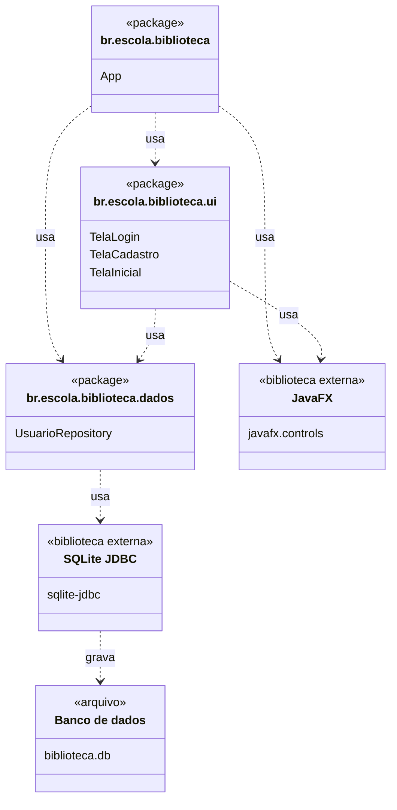

# Documento do Diagrama de Pacotes — Sistema de Biblioteca Escolar

## 1. Visão geral

O diagrama de pacotes apresenta a organização estrutural do Sistema de Biblioteca Escolar, mostrando como o código está dividido em pacotes e como esses elementos dependem uns dos outros. A estrutura possui um pacote principal (`br.escola.biblioteca`), um pacote de interface (`br.escola.biblioteca.ui`) e um pacote de dados (`br.escola.biblioteca.dados`).

O sistema também utiliza bibliotecas externas para a interface gráfica e para a comunicação com o banco de dados. Os dados são armazenados no arquivo `biblioteca.db`.

## 2. Organização dos pacotes

| Pacote ou elemento | Tipo | Elementos identificados | Descrição |
|---|---|---|---|
| `br.escola.biblioteca` | Pacote principal | `App` | Pacote raiz da aplicação, que contém a classe principal `App`. |
| `br.escola.biblioteca.ui` | Pacote | `TelaLogin`, `TelaCadastro`, `TelaInicial` | Reúne as telas da aplicação. |
| `br.escola.biblioteca.dados` | Pacote | `UsuarioRepository` | Reúne o componente responsável pelo acesso aos dados dos usuários. |
| `JavaFX` | Biblioteca externa | `javafx.controls` | Biblioteca externa utilizada pela aplicação. |
| `SQLite JDBC` | Biblioteca externa | `sqlite-jdbc` | Biblioteca externa utilizada para acessar o banco de dados SQLite. |
| `Banco de dados` | Arquivo | `biblioteca.db` | Arquivo no qual os dados do sistema são armazenados. |

## 3. Responsabilidade dos pacotes

### 3.1 Pacote principal — `br.escola.biblioteca`

Contém a classe `App`, que representa o ponto principal da aplicação no diagrama. O pacote principal possui dependências com o pacote de interface, com o pacote de dados e com a biblioteca JavaFX.

### 3.2 Pacote de interface — `br.escola.biblioteca.ui`

Contém as telas utilizadas pelo sistema:

- **TelaLogin:** tela de autenticação do usuário.
- **TelaCadastro:** tela de cadastro.
- **TelaInicial:** tela inicial da aplicação.

O pacote de interface depende do pacote de dados e também utiliza a biblioteca JavaFX.

### 3.3 Pacote de dados — `br.escola.biblioteca.dados`

Contém o componente `UsuarioRepository`, relacionado ao acesso aos dados dos usuários. Esse pacote utiliza a biblioteca externa SQLite JDBC para realizar a comunicação com o banco de dados.

## 4. Bibliotecas e recursos externos

| Elemento | Identificação | Finalidade indicada no diagrama |
|---|---|---|
| JavaFX | `javafx.controls` | Biblioteca externa utilizada pela aplicação e pela interface. |
| SQLite JDBC | `sqlite-jdbc` | Biblioteca externa utilizada pelo pacote de dados. |
| Banco de dados | `biblioteca.db` | Arquivo que recebe os dados gravados pelo SQLite JDBC. |

## 5. Relações e dependências

As setas tracejadas representam dependências entre os pacotes e recursos. O rótulo de cada seta indica o tipo de relação apresentado no diagrama.

| Origem | Destino | Relação |
|---|---|---|
| `br.escola.biblioteca` | `br.escola.biblioteca.ui` | usa |
| `br.escola.biblioteca` | `br.escola.biblioteca.dados` | usa |
| `br.escola.biblioteca.ui` | `br.escola.biblioteca.dados` | usa |
| `br.escola.biblioteca` | `JavaFX` | usa |
| `br.escola.biblioteca.ui` | `JavaFX` | usa |
| `br.escola.biblioteca.dados` | `SQLite JDBC` | usa |
| `SQLite JDBC` | `Banco de dados` (`biblioteca.db`) | grava |

### 5.1 Explicação das relações

- O pacote principal utiliza os pacotes de interface e de dados.
- O pacote principal também utiliza a biblioteca JavaFX.
- O pacote de interface utiliza o pacote de dados e a biblioteca JavaFX.
- O pacote de dados utiliza o SQLite JDBC.
- O SQLite JDBC grava informações no arquivo `biblioteca.db`.

## 6. Funcionamento da estrutura

De acordo com as dependências representadas no diagrama, a aplicação está organizada da seguinte maneira:

1. A classe `App`, localizada no pacote principal, faz parte da estrutura central do sistema.
2. A aplicação utiliza o pacote `ui`, que contém as telas de login, cadastro e tela inicial.
3. A aplicação também possui dependência do pacote `dados`, que contém o `UsuarioRepository`.
4. A interface utiliza JavaFX por meio do recurso `javafx.controls`.
5. O pacote de dados utiliza a biblioteca SQLite JDBC para acessar o banco de dados.
6. O SQLite JDBC grava os dados no arquivo `biblioteca.db`.

## 7. Diagrama

O diagrama de pacotes foi descrito utilizando a sintaxe Mermaid. O código-fonte pode ser encontrado no arquivo `Diagramapacotes.mmd`.

Para visualizar o diagrama, basta abrir o arquivo em um editor ou visualizador compatível com Mermaid. A imagem exportada pode ser armazenada como `diagrama_pacotes.png`.

## 8. Código-fonte do diagrama

